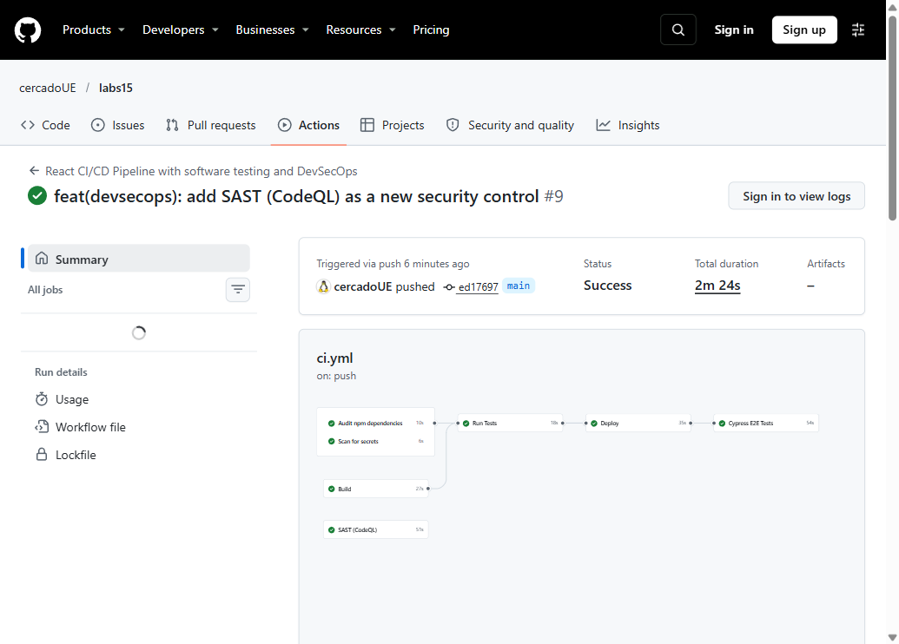
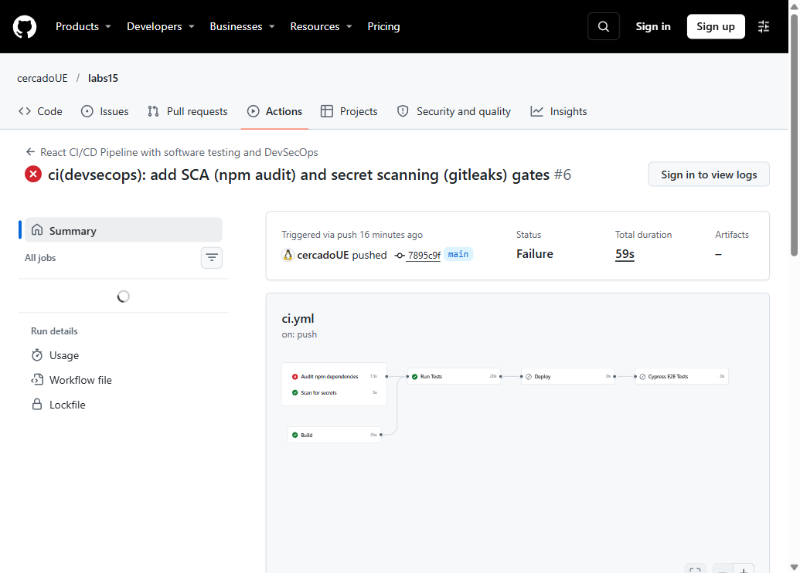
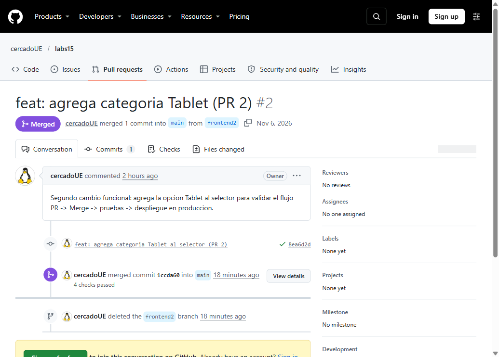
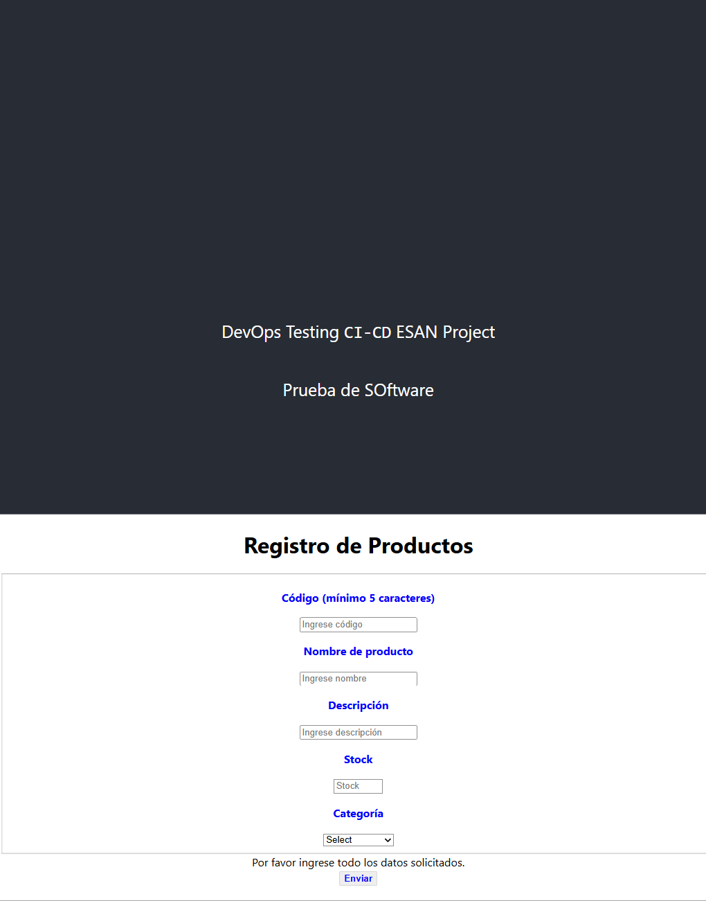

# Evidencia — Laboratorio DevSecOps (React + Vercel + GitHub Actions)

**Repositorio de la aplicación:** https://github.com/cercadoUE/labs15
**Repositorio de pruebas E2E (Cypress):** https://github.com/cercadoUE/cypress15
**Aplicación desplegada:** https://labs15-sand.vercel.app

---

## 1. Pipeline CI/CD + DevSecOps en producción

Última ejecución completa (todos los jobs en verde, incluido el nuevo control SAST):

<https://github.com/cercadoUE/labs15/actions/runs/42164803112>



| Job | Control |
|---|---|
| Audit npm dependencies | SCA — `npm audit --audit-level=high` |
| Scan for secrets | Secret Scanning — Gitleaks sobre todo el historial |
| **SAST (CodeQL)** | **SAST — control nuevo agregado (paso 21)** |
| Build | Compilación de producción |
| Run Tests | Pruebas unitarias (`npm test`) |
| Deploy | Despliegue a Vercel (solo push a `main`) |
| Cypress E2E Tests | Pruebas E2E sobre la URL desplegada |

---

## 2. Paso 19 — El pipeline falla por el análisis de dependencias

Run con el `ci_v2.yml` aplicado y las dependencias originales:

<https://github.com/cercadoUE/labs15/actions/runs/42163782205>



```
Audit npm dependencies  -> failure
Scan for secrets        -> success
Build                   -> success
```

Reporte original del proyecto: **71 vulnerabilidades (4 críticas, 33 altas)**.

---

## 3. Paso 20 — Corrección de dependencias

Run posterior a la corrección: **Status Success** (todos los jobs).
<https://github.com/cercadoUE/labs15/actions/runs/42164197196>

Resultado final del `npm audit --audit-level=high`: **exit 0**
`0 critical / 0 high` — quedan 23 avisos low/moderate que no bloquean la compuerta.

Cambios aplicados:

1. `npm audit fix` para las actualizaciones no disruptivas.
2. `overrides` en `package.json` para forzar versiones corregidas de dependencias
   transitivas de `react-scripts`:

   | Paquete | Versión forzada | Motivo |
   |---|---|---|
   | `postcss` | `^8.5.32` | lectura arbitraria de archivos vía `sourceMappingURL` |
   | `serialize-javascript` | `^7.1.4` | RCE / XSS / DoS |
   | `svgo` | `^2.8.4` | `removeScripts` incompleto (XSS en SVG) |
   | `webpack-dev-server` | `^5.2.5` | exposición de código fuente, CSRF, DoS |
   | `webpack-dev-middleware` | `^7.4.5` | path traversal |
   | `jsonpath` | `^1.1.2` | recursión / DoS |
   | `underscore` | `^1.13.8` | recursión ilimitada / DoS |

3. `patches/react-scripts+5.0.1.patch` (aplicado con `patch-package` en `postinstall`):
   adapta `react-scripts` a la API de `webpack-dev-server` 5 (`server` y
   `setupMiddlewares`), de modo que `npm start` siga funcionando en local.
4. Jobs de CI actualizados a **Node 20** (requisito de `serialize-javascript` 7).

Verificación local: `npm ci`, `npm run build`, `npm test` y `npm start` funcionando.

---

## 4. Pasos 15 a 17 — Ramas, Pull Requests y despliegue

| Paso | Evidencia |
|---|---|
| Rama `frontend1` + opción "Computadora" | PR #1: https://github.com/cercadoUE/labs15/pull/1 |
| Segundo cambio + despliegue en producción | PR #2: https://github.com/cercadoUE/labs15/pull/2 |



Cada merge disparó automáticamente el pipeline (Build → Tests → Deploy → Cypress E2E)
y publicó la nueva versión en producción.



---

## 5. Paso 21 — Nuevo control DevSecOps: SAST con CodeQL

Se agregó el job `sast-codeql` al pipeline:

```yaml
  sast-codeql:
    name: SAST (CodeQL)
    runs-on: ubuntu-latest
    permissions:
      contents: read
      security-events: write
      actions: read
    steps:
      - uses: actions/checkout@v4
      - uses: github/codeql-action/init@v4
        with:
          languages: javascript-typescript
          build-mode: none
          queries: security-extended
      - uses: github/codeql-action/analyze@v4
        with:
          category: "/language:javascript-typescript"
```

**Resultado de la ejecución:** 103 reglas de seguridad aplicadas sobre el código
JavaScript/TypeScript, **0 hallazgos**. Los resultados quedan publicados en
`Security → Code scanning` del repositorio y se actualizan en cada push.

**Por qué este control aporta valor:** los controles previos analizaban
dependencias (SCA) y credenciales (secret scanning), pero no el código propio.
CodeQL cubre esa brecha detectando patrones inseguros (XSS, inyección,
manejo inseguro de datos) antes de llegar a producción.

---

## 6. Matriz de controles implementados

| Control | Herramienta | Objetivo | Estado |
|---|---|---|---|
| SCA | `npm audit` | Detectar dependencias vulnerables | Implementado |
| Secret Scanning | Gitleaks | Detectar credenciales expuestas | Implementado |
| Control de permisos | `permissions:` en el workflow | Aplicar mínimo privilegio | Implementado |
| Gestión de secretos | GitHub Secrets | Proteger tokens de acceso | Implementado |
| Quality Gate | `needs` + condiciones | Bloquear despliegues si fallan controles | Implementado |
| Build Validation | `npm run build` | Validar compilación | Implementado |
| Pruebas unitarias | `npm test` | Validar funcionalidades | Implementado |
| Pruebas E2E | Cypress | Validar flujos completos | Implementado |
| **SAST** | **CodeQL** | **Detectar vulnerabilidades en código propio** | **Implementado (nuevo)** |
| DAST | OWASP ZAP | Detectar vulnerabilidades en la app desplegada | No implementado |
| SBOM | Syft / CycloneDX | Generar inventario de componentes | No implementado |
| Análisis de licencias | Herramientas SCA | Detectar riesgos de licenciamiento | No implementado |
